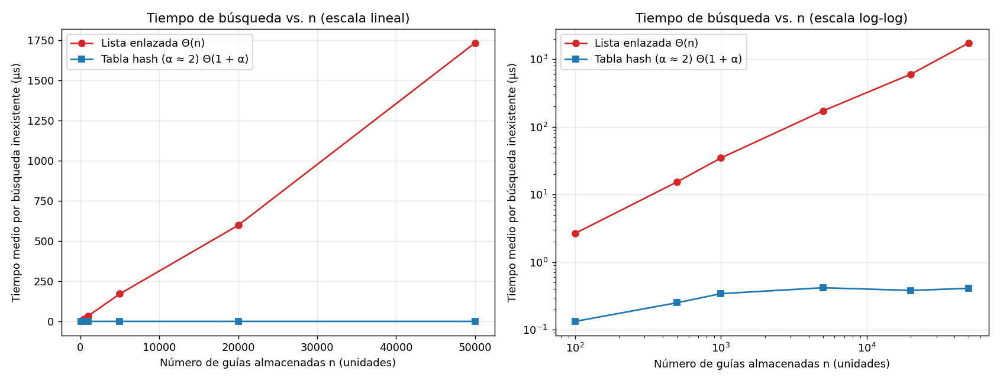
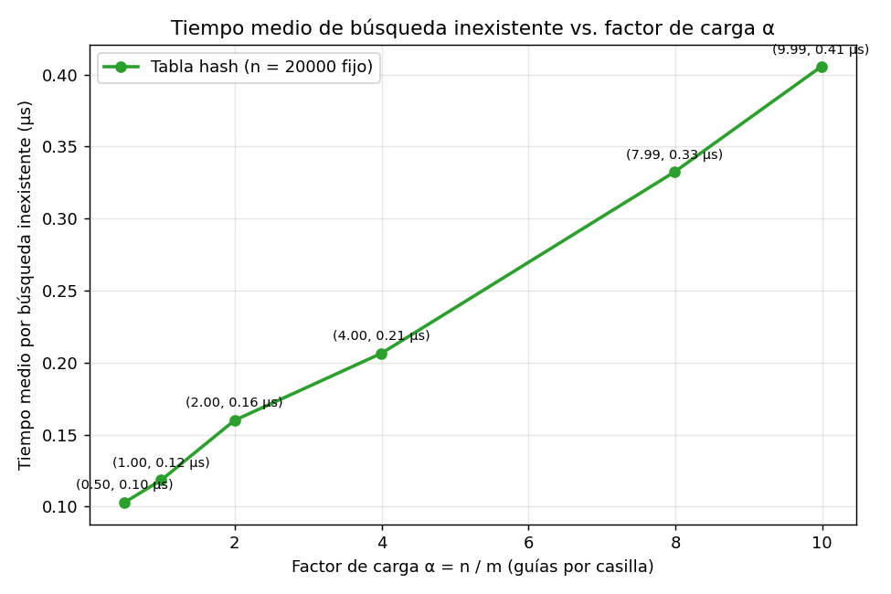

# Laboratorio evaluativo 03 — Estructuras de datos

**Autora:** Sara López Cardona

## Cómo reproducir

Desde la raíz del repositorio en PowerShell:

```powershell
venv\Scripts\Activate.ps1
cd laboratorios\lab3-estructuras-datos
python -B pruebas.py     # verifica ListaEnlazada y TablaHash con assert
python -B medicion.py    # ejecuta los experimentos A y B y genera las gráficas
```

## Parte 1 — Implementar y verificar

Código: [estructuras.py](estructuras.py) y [pruebas.py](pruebas.py).

`estructuras.py` tiene `Nodo`, `ListaEnlazada` (inserción al inicio en Θ(1) y búsqueda iterativa con `while`) y `TablaHash` con encadenamiento y módulo (`k % m`), usando una `ListaEnlazada` por casilla sin `dict`, `set` ni `hash()`.

`pruebas.py` comprueba con `assert`: lista y tabla vacías; búsquedas exitosas e infructuosas con las 4 guías del enunciado; la colisión forzada en m = 7 donde 10, 24 y 17 caen en la casilla 3 (longitud 3 y `factor_carga() == 3 / 7`); y 25 colecciones aleatorias (semilla 2026) verificando que lista y tabla coinciden en guías existentes y en 30 inexistentes.

## Parte 2 — Medir y graficar

Código: [medicion.py](medicion.py).



| n | m | α = n/m | Lista (µs) | Tabla (µs) |
|---:|---:|---:|---:|---:|
| 100 | 53 | 1,89 | 2,654 | 0,133 |
| 500 | 251 | 1,99 | 15,309 | 0,251 |
| 1.000 | 503 | 1,99 | 34,646 | 0,342 |
| 5.000 | 2.503 | 2,00 | 171,622 | 0,418 |
| 20.000 | 10.007 | 2,00 | 598,321 | 0,382 |
| 50.000 | 25.013 | 2,00 | 1.733,564 | 0,409 |



| m (n = 20.000) | α = n/m | Tabla (µs) |
|---:|---:|---:|
| 40.009 | 0,50 | 0,103 |
| 20.011 | 1,00 | 0,118 |
| 10.007 | 2,00 | 0,160 |
| 5.003 | 4,00 | 0,206 |
| 2.503 | 7,99 | 0,332 |
| 2.003 | 9,99 | 0,405 |

Medición: guías de 10 dígitos con semilla 42 y 200 inexistentes con semilla 7, usando las mismas guías en ambas estructuras y verificando antes 50 existentes. Solo se mide la búsqueda con `time.perf_counter()` (5 repeticiones, tomando el mínimo).

## Parte 3 — Análisis

**1. Costo teórico.** Si buscamos una guía que no existe en la lista enlazada, el `while` arranca en la cabeza y pasa nodo por nodo hasta llegar a `None`. No hay forma de saltar elementos ni parar antes, así que revisa los n nodos sí o sí y cuesta Θ(n). En la tabla hash no recorremos todo: primero calculamos `guia % m` para ir a la casilla en Θ(1) y solo miramos la lista de ese cajón. Al repartir n guías en m casillas, cada lista tiene en promedio α = n / m datos, así que buscar cuesta en promedio Θ(1 + α) (el cálculo del hash más recorrer esa lista corta). Esto se apoya en el **supuesto de hash uniforme simple**, que asume que cada guía tiene la misma probabilidad 1/m de caer en cualquier casilla de forma independiente. Si todas las guías cayeran en la misma casilla, quedarían m - 1 vacías y una sola lista con los n nodos: la tabla se vuelve una lista enlazada y buscar cuesta Θ(n).

**2. Lo medido contra lo esperado.** En la primera gráfica, pasando de n = 1.000 a n = 5.000 (n × 5), la lista sube de 34,646 µs a 171,622 µs (se multiplica por 4,95); y de 5.000 a 20.000 (n × 4) pasa de 171,622 µs a 598,321 µs (×3,49). Crece al ritmo de n, tal como dice Θ(n). En ese mismo paso de 5.000 a 20.000, la tabla hash pasa de 0,418 µs a 0,382 µs (factor de 0,91) y en 50.000 da 0,409 µs (×1,07). Como m creció junto con n para dejar α ≈ 2 fijo, la curva de la tabla se queda plana en torno a 0,4 µs y cumple Θ(1) (de 100 a 1.000 sube de 0,133 a 0,342 µs porque la tabla crece y pesa más en caché). En la segunda gráfica (n = 20.000 fijo), cuando α sube de 0,50 a 9,99 el tiempo sube en línea recta de 0,103 µs a 0,405 µs. Esto encaja con Θ(1 + α): hay una base fija de ~0,09 µs por calcular la casilla y luego suma unos 0,03 µs por cada nodo extra que toca recorrer en la cadena.

**3. Explique las colisiones.** Hay colisión cuando dos guías distintas dan el mismo residuo en `k % m` y caen en el mismo cajón. Ocurre aunque haya más casillas que guías (m > n) porque hay 9.000 millones de posibles guías de 10 dígitos para solo m casillas, así que muchos números terminan con el mismo residuo. Con m = 7 pasa con las guías 10, 24 y 17: al dividir por 7 las tres sobran 3 (10 = 7×1 + 3, 24 = 7×3 + 3, 17 = 7×2 + 3) y chocan en la casilla 3. El **encadenamiento** guarda las tres en la lista enlazada de la casilla 3; su ventaja es que la tabla nunca se llena y soporta α > 1, pero gasta más memoria por los punteros de cada nodo. El **direccionamiento abierto** mete todo en el mismo arreglo buscando otra casilla vacía (con sondeo lineal, el 10 queda en la 3, el 24 pasa a la 4 y el 17 a la 5); ahorra punteros y aprovecha mejor la caché, pero exige α ≤ 1, forma filas ocupadas que alargan las búsquedas y al borrar necesita marcas ("lápidas").

**4. Tabla hash o árbol de búsqueda.** Para buscar "guías entre X y Y", la tabla hash no sirve. El módulo revuelve las claves y pierde el orden numérico: la guía 1000000010 y la 1000000011 caen en cajones distintos, así que para sacar un rango tocaría revisar las m casillas y las n guías en Θ(n + m). Un árbol de búsqueda binario (BST) sí mantiene el orden (menores a la izquierda, mayores a la derecha), lo que deja ubicar X en Θ(h) y sacar las k guías del rango en Θ(h + k). Pero si las 400.000 guías llegan ya ordenadas y se insertan una por una en un BST simple, cada guía nueva es mayor que la anterior y cae siempre a la derecha. El árbol queda como una fila de altura h = n - 1 = 399.999 y buscar hace hasta 400.000 comparaciones (como la lista). En un árbol equilibrado la altura sería h ≈ log₂(400.000) ≈ 18, haciendo solo unas 18 o 19 comparaciones.

**5. Concepto para la jefa de operaciones.** Recomiendo usar las dos estructuras juntas: una **tabla hash** (con α ≈ 2) para las consultas del call center en Θ(1), y un **árbol binario balanceado** (AVL o rojo-negro, que se reacomoda solo para no volverse fila si entran datos ordenados) para sacar los rangos diarios entre X y Y en Θ(log n + k). Para 5.000.000 de envíos, **es una estimación** y no una medición. Parto de n = 50.000: llegar a 5.000.000 multiplica n por 100. Como la gráfica muestra que la lista es lineal Θ(n), su tiempo se multiplica por 100: pasa de 1.733,564 µs (1,73 ms) a unos 173.356 µs ≈ 0,173 s por consulta fallida (con varias llamadas en hora pico se acumulan segundos de espera). En la tabla hash, subiendo m a ~2.500.000 para mantener α ≈ 2, el costo sigue siendo constante Θ(1 + α) con 2 nodos por casilla en promedio, así que seguirá tardando cerca de 0,41 µs (o menos de 1 µs por la RAM).
